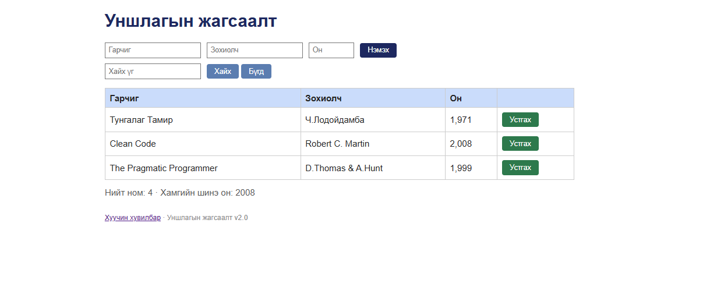
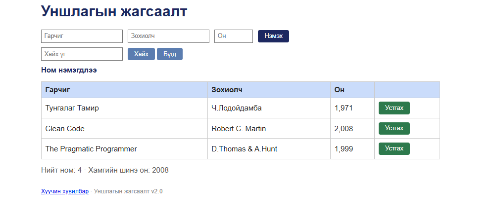

# BUG-01: Нүүр хуудасны «Нийт ном» тоолуур хүснэгтийн номын тооноос үргэлж 1-ээр их харагддаг

**Орчин:** Уншлагын жагсаалт v2.0, Google Chrome 155.0.8059.85, Windows 11 Home (10.0.26200), 2026-10-20  
**Урьдчилсан нөхцөл:** node app.js-ийг шинээр асаасан (анхны 3 ном), http://localhost:3000-ийг Chrome-оор нээсэн

## Дахин гаргах алхам

1. Аппыг шинээр асааж http://localhost:3000-ийг нээнэ (юу ч дарахгүй).
2. Хүснэгтэд байгаа мөрийг тоолно — 3 ном (Тунгалаг Тамир, Clean Code, The Pragmatic Programmer).
3. Хүснэгтийн доорх «Нийт ном: ...» тоог харна.
4. (Нэмэлт) Гарчиг = «Шинэ», Зохиолч = «Х», Он = «2000» бичээд «Нэмэх» дарж, мөр ба тоолуурыг дахин харьцуулна.

**Хүлээгдэж байсан:** «Нийт ном» тоолуур хүснэгтэд буй номын тоотой тэнцүү — эхэнд «Нийт ном: 3».

**Бодит үр дүн:** Хүснэгтэд 3 мөр байхад «Нийт ном: 4 · Хамгийн шинэ он: 2008». Ном нэмэхэд (4 мөр → 5) ба устгахад (2 мөр → 3) тоолуур дагаж өөрчлөгддөг ч зөрүү үргэлж +1 хэвээр. GET /api/books-ийн id-ууд 1, 2, 3, 5, … буюу id 4 алга — харагдахгүй 4 дэх бичлэгийг тоолж байх магадлалтай.

**Ноцтой байдал:** Major — хэрэглэгчид харуулж буй тоон мэдээлэл буруу; ямар ч үйлдэлгүйгээр анхнаасаа гарч, бүх үйлдлийн дараа хадгалагдана.

**Хавсралт:** `screenshots/bug-01-fresh.png` · `screenshots/bug-01.png`

**Олдсон аялал:** Supermodel (GUI-ийг харж спецификацитай тулгах)

