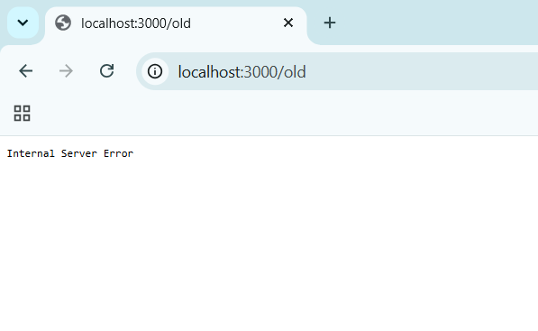

# BUG-04: Хуудасны доорх «Хуучин хувилбар» линк /old хуудас руу орж 500 Internal Server Error өгдөг

**Орчин:** Уншлагын жагсаалт v2.0, Google Chrome 155.0.8059.85, Windows 11 Home (10.0.26200), 2026-10-20  
**Урьдчилсан нөхцөл:** node app.js-ийг шинээр асаасан (анхны 3 ном), http://localhost:3000-ийг Chrome-оор нээсэн

## Дахин гаргах алхам

1. Аппыг шинээр асааж http://localhost:3000-ийг нээнэ.
2. Хуудасны хамгийн доор «Хуучин хувилбар» линкийг дарна.
3. (API түвшинд) curl -i localhost:3000/old

**Хүлээгдэж байсан:** «... бүх хуудас, линк ажиллана.»

**Бодит үр дүн:** Браузер localhost:3000/old руу орж «Internal Server Error» гэсэн цагаан хуудас харуулна. curl -i: HTTP/1.1 500 Internal Server Error.

**Ноцтой байдал:** Major — үндсэн хуудсан дээр байрлах линк серверийн алдаа өгч, хэрэглэгч гацна; серверийн дотоод алдаа шууд ил гарна.

**Хавсралт:** `screenshots/bug-04.png` · `evidence/bug-04-curl.txt`

**Олдсон аялал:** Supermodel (линк бүрийг дарж үзэх)

Нотолгоо: [evidence/bug-04-curl.txt](../evidence/bug-04-curl.txt)
