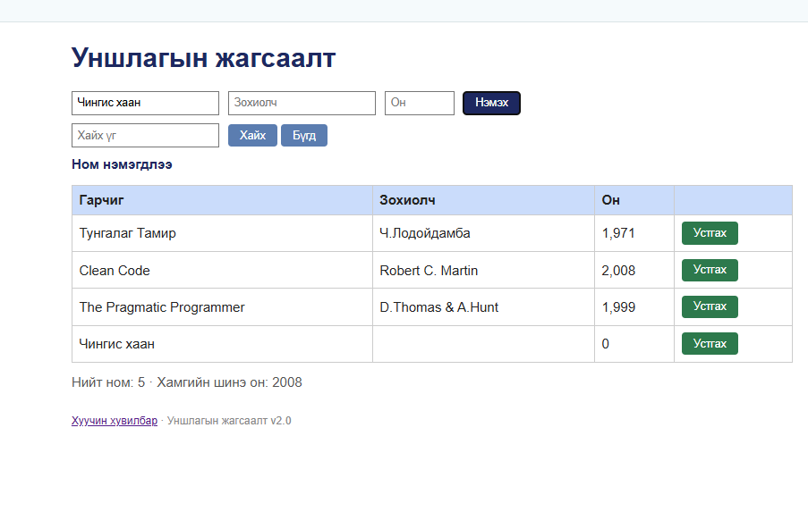
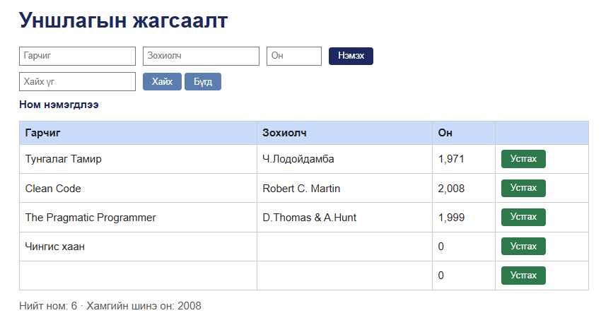
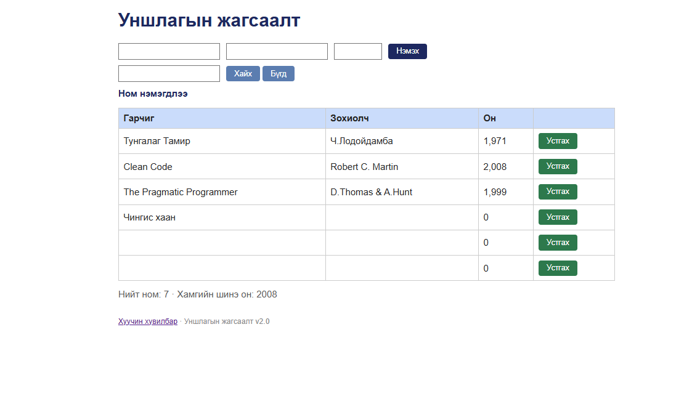

# BUG-05: Ном нэмэх маягт заавал талбарыг шалгадаггүй — хоосон Зохиолч/Он, бүр бүх талбар хоосон ном нэмэгддэг

**Орчин:** Уншлагын жагсаалт v2.0, Google Chrome 155.0.8059.85, Windows 11 Home (10.0.26200), 2026-10-20  
**Урьдчилсан нөхцөл:** node app.js-ийг шинээр асаасан (анхны 3 ном), http://localhost:3000-ийг Chrome-оор нээсэн

## Дахин гаргах алхам

1. Аппыг шинээр асааж http://localhost:3000-ийг нээнэ.
2. Гарчиг = «Чингис хаан» бичнэ, Зохиолч ба Он хоосон үлдээнэ.
3. «Нэмэх» дарна.
4. Гурван талбарыг бүгдийг хоосон үлдээгээд «Нэмэх» дарна.
5. Гурван талбарт зөвхөн хоосон зай (space) бичээд «Нэмэх» дарна.

**Хүлээгдэж байсан:** «Ном нэмэхэд Гарчиг, Зохиолч, Он гурван талбар бүгд заавал бөглөгдсөн байх ёстой; дутуу бол ном нэмэгдэхгүй, ойлгомжтой алдааны мессеж харагдана.»

**Бодит үр дүн:** 3 тохиолдол бүрд «Ном нэмэгдлээ» мессеж гарч хүснэгтэд шинэ мөр нэмэгдэнэ: «Чингис хаан | (хоосон) | 0», «(хоосон) | (хоосон) | 0», «(зай) | (зай) | 0». Алдааны мессеж огт гарахгүй.

**Ноцтой байдал:** Major — хүчингүй, хоосон өгөгдөл хадгалагдаж жагсаалтыг бохирдуулна; хэрэглэгчид амжилттай гэж худал мэдээлнэ.

**Тэмдэглэл:** Гарчиг/Зохиолч/Он хоосон, зөвхөн зай — нэг шалтгааны (заавал талбарын шалгалт байхгүй) хувилбарууд тул нэг тайланд нэгтгэв.

**Хавсралт:** `screenshots/bug-05.png` · `screenshots/bug-05-empty.png` · `screenshots/bug-05-spaces.png`

**Олдсон аялал:** Couch Potato (хоосон / хамгийн бага оролт)

