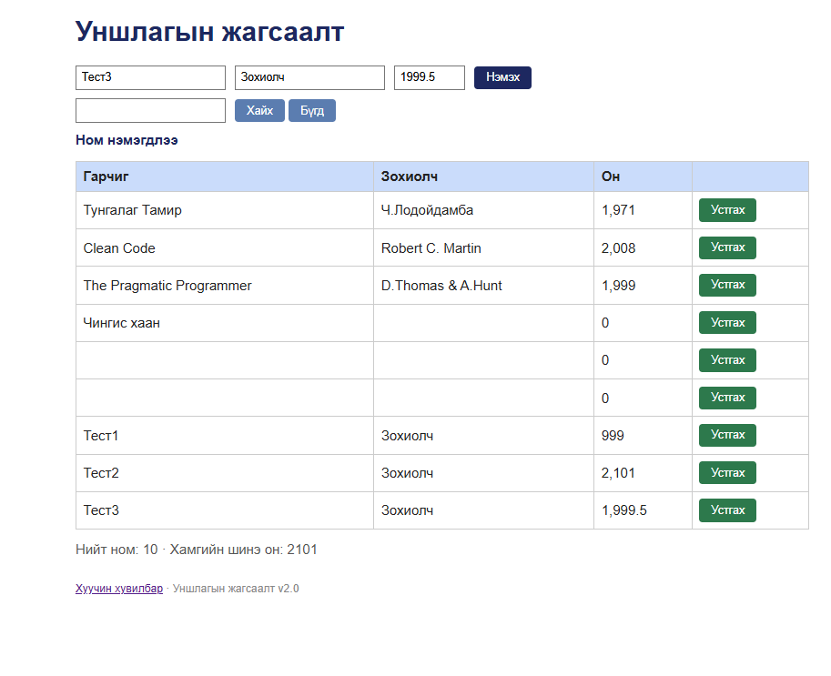

# BUG-06: Он 1000-2100 хязгаарыг шалгадаггүй — 999, 2101, 1999.5 гэсэн он хүлээн авдаг

**Орчин:** Уншлагын жагсаалт v2.0, Google Chrome 155.0.8059.85, Windows 11 Home (10.0.26200), 2026-10-20  
**Урьдчилсан нөхцөл:** node app.js-ийг шинээр асаасан (анхны 3 ном), http://localhost:3000-ийг Chrome-оор нээсэн

## Дахин гаргах алхам

1. Аппыг шинээр асааж http://localhost:3000-ийг нээнэ.
2. Гарчиг = «Тест1», Зохиолч = «Зохиолч», Он = «999» → «Нэмэх».
3. Гарчиг = «Тест2», Зохиолч = «Зохиолч», Он = «2101» → «Нэмэх».
4. Гарчиг = «Тест3», Зохиолч = «Зохиолч», Он = «1999.5» → «Нэмэх».
5. Хүснэгт болон «Хамгийн шинэ он» утгыг харна.

**Хүлээгдэж байсан:** «Он нь 1000-2100 хоорондох бүхэл тоо» — хязгаараас гадуурх эсвэл бутархай он хүлээн авахгүй, алдааны мессеж гарна.

**Бодит үр дүн:** Гурвуулаа «Ном нэмэгдлээ» мессежтэй нэмэгдэж хүснэгтэд «999», «2,101», «1,999.5» гэж харагдана. Хүчингүй он статистикт ч орж «Хамгийн шинэ он: 2101» болно.

**Ноцтой байдал:** Major — хүчингүй он хадгалагдаж, түүн дээр тулгуурласан «Хамгийн шинэ он» статистик буруу гарна.

**Хавсралт:** `screenshots/bug-06.png`

**Олдсон аялал:** Couch Potato (хязгаарын утга)

