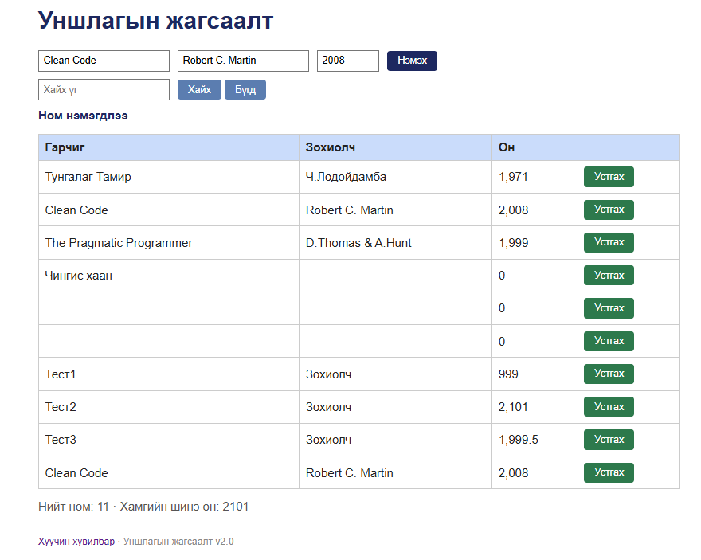

# BUG-07: Ижил гарчиг, зохиолчтой номыг давхардуулан нэмэх боломжтой

**Орчин:** Уншлагын жагсаалт v2.0, Google Chrome 155.0.8059.85, Windows 11 Home (10.0.26200), 2026-10-20  
**Урьдчилсан нөхцөл:** node app.js-ийг шинээр асаасан (анхны 3 ном), http://localhost:3000-ийг Chrome-оор нээсэн

## Дахин гаргах алхам

1. Аппыг шинээр асааж http://localhost:3000-ийг нээнэ.
2. Гарчиг = «Clean Code», Зохиолч = «Robert C. Martin», Он = «2008» бичнэ (анхнаасаа байгаа номтой яг ижил).
3. «Нэмэх» дарна.

**Хүлээгдэж байсан:** «Ижил гарчиг, зохиолчтой ном давхардуулж нэмэгдэхгүй.» — давхардлын алдааны мессеж гарах ёстой.

**Бодит үр дүн:** «Ном нэмэгдлээ» мессеж гарч хүснэгтэд 2 ширхэг «Clean Code | Robert C. Martin | 2,008» мөр болно.

**Ноцтой байдал:** Major — өгөгдлийн бүрэн бүтэн байдлын дүрэм зөрчигдөж, жагсаалт ба тоолуур бодит номын тоог буруу харуулна.

**Хавсралт:** `screenshots/bug-07.png`

**Олдсон аялал:** FedEx (нэг номын өгөгдлийг замаар нь дагах)

