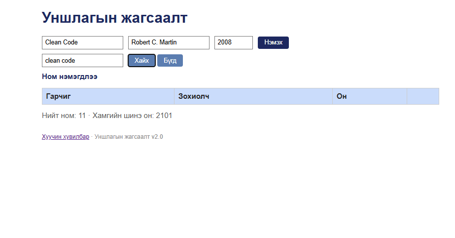
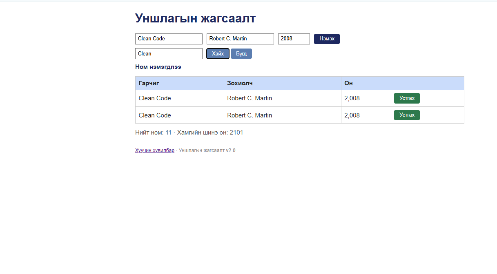
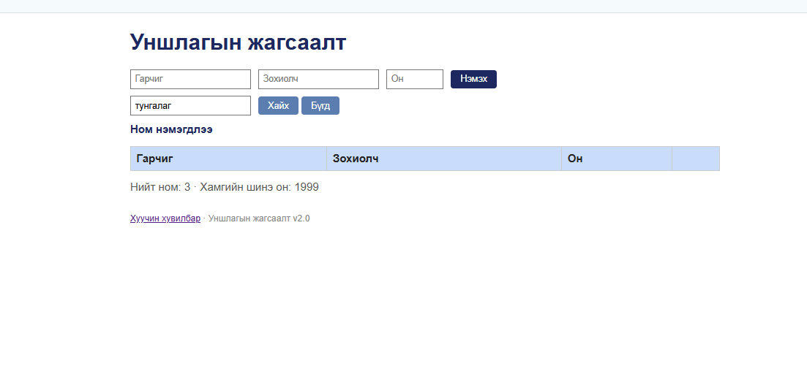

# BUG-08: Хайлт том/жижиг үсэг ялгадаг — «clean code», «тунгалаг» гэж хайхад юу ч олддоггүй

**Орчин:** Уншлагын жагсаалт v2.0, Google Chrome 155.0.8059.85, Windows 11 Home (10.0.26200), 2026-10-20  
**Урьдчилсан нөхцөл:** node app.js-ийг шинээр асаасан (анхны 3 ном), http://localhost:3000-ийг Chrome-оор нээсэн

## Дахин гаргах алхам

1. Аппыг шинээр асааж http://localhost:3000-ийг нээнэ.
2. «Хайх үг» талбарт «clean code» (жижиг үсгээр) бичиж «Хайх» дарна.
3. «Хайх үг»-ийг «Clean» (том C) болгож «Хайх» дарна.
4. «Хайх үг»-ийг «тунгалаг» (жижиг үсгээр) болгож «Хайх» дарна.

**Хүлээгдэж байсан:** «Хайлт гарчиг болон зохиолчоос хайх ба том/жижиг үсэг ЯЛГАХГҮЙ.» — «clean code» нь «Clean Code»-ийг, «тунгалаг» нь «Тунгалаг Тамир»-ыг олох ёстой.

**Бодит үр дүн:** «clean code» → 0 мөр; «Clean» → 1 мөр (Clean Code); «тунгалаг» → 0 мөр. Хайлт ажилладаг ч зөвхөн яг ижил том/жижиг үсэгтэй үед олдоно — латин болон кирилл үсгийн аль алинд.

**Ноцтой байдал:** Major — үндсэн функц нийтлэг хэрэглээнд (жижиг үсгээр хайх) ажиллахгүй, хэрэглэгч ном байхгүй гэж буруу дүгнэнэ.

**Хавсралт:** `screenshots/bug-08.png` · `screenshots/bug-08-control.png` · `screenshots/bug-08-mongolian.png`

**Олдсон аялал:** FedEx

