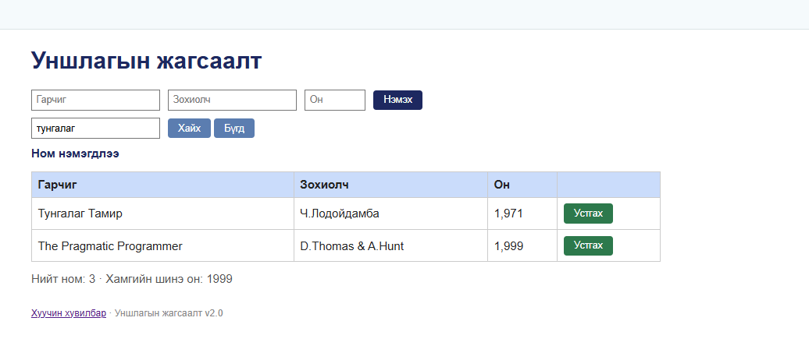
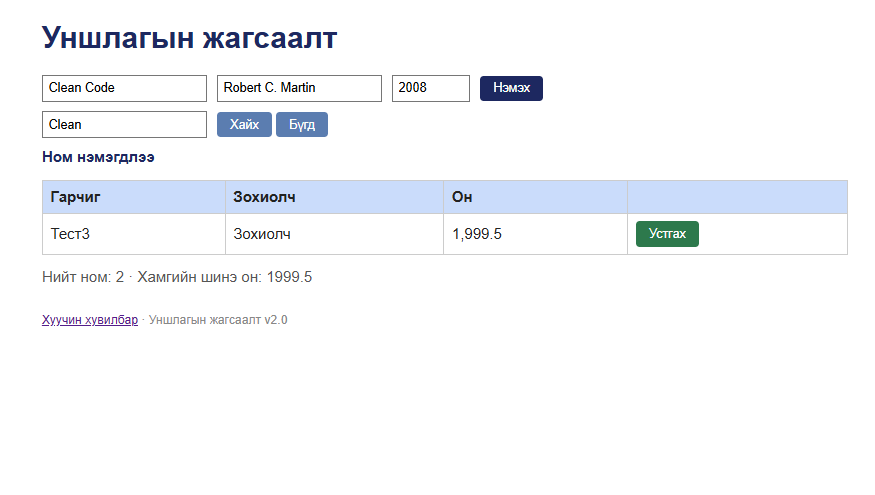

# BUG-10: Ном устгасны дараа «устгагдлаа» биш «Ном нэмэгдлээ» мессеж харагддаг

**Орчин:** Уншлагын жагсаалт v2.0, Google Chrome 155.0.8059.85, Windows 11 Home (10.0.26200), 2026-10-20  
**Урьдчилсан нөхцөл:** node app.js-ийг шинээр асаасан (анхны 3 ном), http://localhost:3000-ийг Chrome-оор нээсэн

## Дахин гаргах алхам

1. Аппыг шинээр асааж http://localhost:3000-ийг нээнэ.
2. «Clean Code» мөрийн «Устгах» товчийг дарна.
3. Хүснэгтийн дээрх мессежийг уншина.

**Хүлээгдэж байсан:** «Үйлдэл бүрийн дараах мессеж тухайн үйлдэлдээ тохирно» — устгахад устгасныг илэрхийлсэн мессеж гарна.

**Бодит үр дүн:** Мөр устаж хүснэгтэд 2 ном үлдэнэ, гэвч мессеж «Ном нэмэгдлээ» гэж гарна. Хайлтын дараа ч ижил мессеж үлддэг.

**Ноцтой байдал:** Minor — үйлдэл зөв гүйцэтгэгдэх ч мессеж эсрэг утгатай тул хэрэглэгчийг төөрөгдүүлнэ.

**Хавсралт:** `screenshots/bug-10-fresh.png` · `screenshots/bug-10.png`

**Олдсон аялал:** FedEx (нэмэх → хайх → устгах зам)

