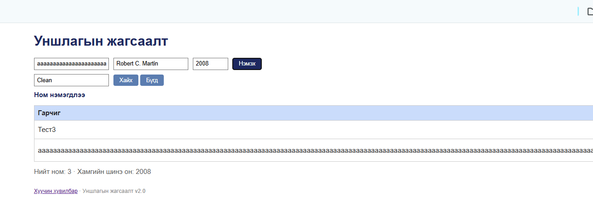

# BUG-11: Маш урт гарчигтай ном нэмэхэд хүснэгт дэлгэцээс хэтэрч Зохиолч/Он/Устгах баганууд харагдахгүй болдог

**Орчин:** Уншлагын жагсаалт v2.0, Google Chrome 155.0.8059.85, Windows 11 Home (10.0.26200), 2026-10-20  
**Урьдчилсан нөхцөл:** node app.js-ийг шинээр асаасан (анхны 3 ном), http://localhost:3000-ийг Chrome-оор нээсэн

## Дахин гаргах алхам

1. Аппыг шинээр асааж http://localhost:3000-ийг 1280px өргөн цонхонд нээнэ.
2. Гарчигт хоосон зайгүй 300 тэмдэгт (жишээ нь «а» үсгийг 300 удаа) бичнэ, Зохиолч = «Robert C. Martin», Он = «2008».
3. «Нэмэх» дарна.

**Хүлээгдэж байсан:** «... хүснэгт ямар ч урттай оролтод эвдрэхгүй.» — урт текст мөр шилжих эсвэл товчлогдох ёстой.

**Бодит үр дүн:** Хүснэгт баруун тийш сунаж (1280px цонхонд хүснэгтийн өргөн ~2954px), «Зохиолч», «Он», «Устгах» баганууд дэлгэцээс гарч хэвтээ гүйлгэхгүйгээр харагдахгүй.

**Ноцтой байдал:** Minor — өгөгдөл зөв хадгалагдах ч бүх мөрийн «Устгах» товч дэлгэцээс гарч, хуудасны зохион байгуулалт эвдэрнэ.

**Хавсралт:** `screenshots/bug-11.png`

**Олдсон аялал:** FedEx (урт оролтыг замаар нь дагах)

